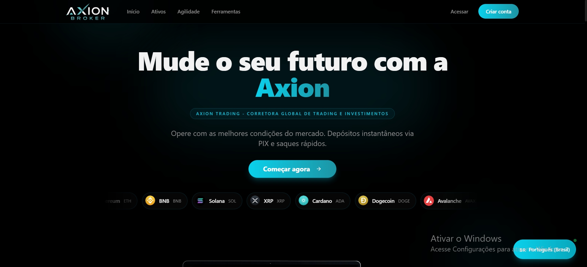

# White Label Binary Options Platform | AXION

**Sistemas White Label · Custom software development**

[Português](README.md) · [Español](README.es.md) · [English](README.en.md)

Custom software development for white label binary options brokerage projects. AXION is presented through its own visual identity, landing page and demo-account trading terminal.

**[Request a quote · WhatsApp](https://wa.me/5511912536227?text=Hi!%20I%20found%20the%20AXION%20White%20Label%20project%20on%20GitHub%20and%20would%20like%20to%20request%20a%20quote.)** · **[GitHub](https://github.com/Sistemas-Proficional)**

## Explore the documentation

| Document | What you will find |
| --- | --- |
| [Scope and integrations](docs/en/scope-and-integrations.md) | Presented interface, customization, APIs and delivery criteria. |
| [Frequently asked questions](docs/en/frequently-asked-questions.md) | Code, demonstration, integrations and project terms. |
| [Tag and topic glossary](docs/keyword-glossary.md) | All requested terms, organized by subject. |
| [Contact](CONTACT.md) | Contact channel and information for requesting a quote. |

## Explore the interface

### Landing page

*AXION branding, navigation and sign-up and sign-in entry points.*

### Demo-account terminal

*BTC/USDT chart, amount, expiration and trade direction in an account explicitly marked as demo.*

## What is presented

| Area | Visual reference |
| --- | --- |
| Visual identity | AXION branding, a dark theme and blue highlights. |
| Entry page | Platform presentation and institutional navigation. |
| Trading chart | Candlestick view displaying the BTC/USDT asset. |
| Operation controls | Amount, expiration and up/down controls. |
| Terminal navigation | Wallet, history, indicators and drawing tools. |

The images document the interface. APIs, execution, payments, administration and other features are defined and validated according to project scope.

## How to discuss your project

1. Describe your idea, brand and audience.
2. List the features and integrations you need.
3. Share references and your expected timeline.
4. Agree on deliverables, code access, testing and support in the proposal.

**[Request a quote · WhatsApp +55 11 91253-6227](https://wa.me/5511912536227?text=Hi!%20I%20found%20the%20AXION%20White%20Label%20project%20on%20GitHub%20and%20would%20like%20to%20request%20a%20quote.)**

[Explore other projects](https://github.com/Sistemas-Proficional/Sistemas-Proficional/tree/main/portfolio)

This repository contains portfolio documentation and images. Implementation delivery and commercial terms are discussed in the project proposal.
